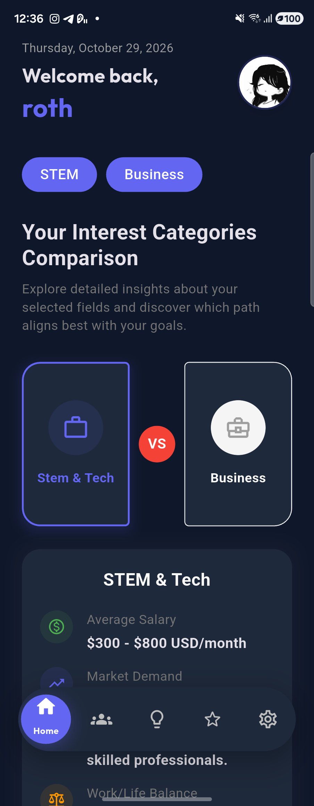
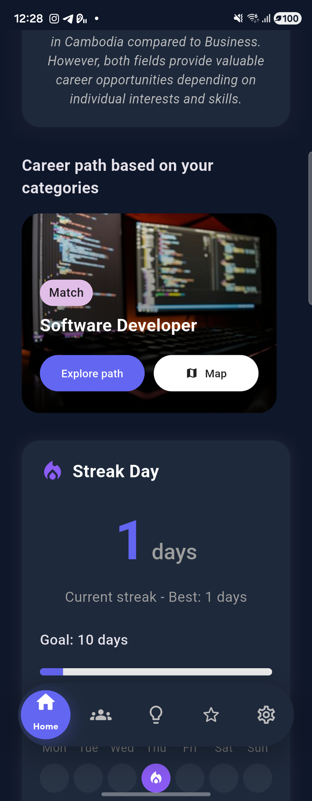
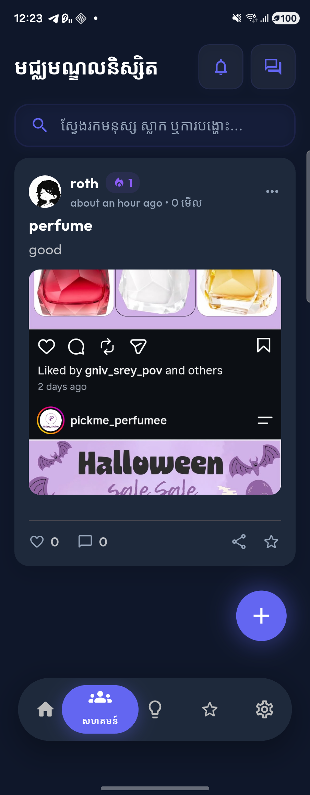
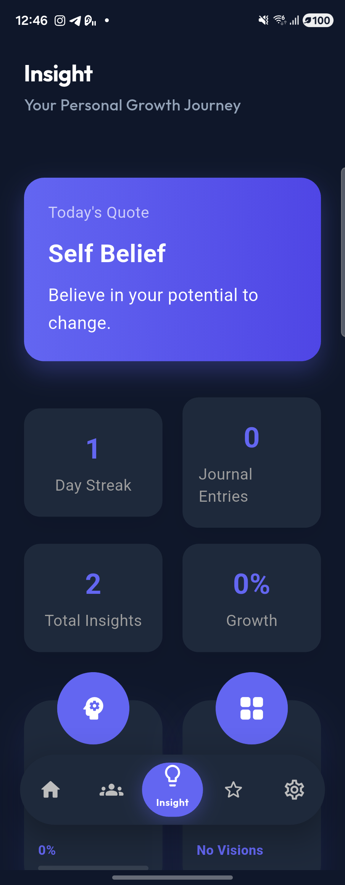
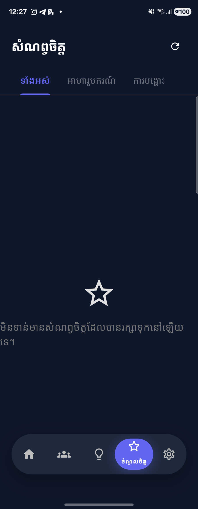
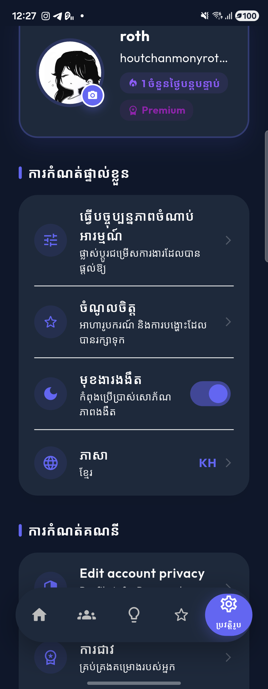

<div align="center">

# Evolve — AI-Powered Student Career, Scholarship & Community Platform

**Empowering Cambodian students to discover career paths, compare university majors, scout real-time scholarships, and grow together in an interactive student community.**

[](https://flutter.dev)
[](https://dart.dev)
[](https://nodejs.org)
[](https://supabase.com)
[](https://socket.io)
[](https://firebase.google.com)

</div>

---

## 📖 Overview

**Evolve** is a full-stack mobile platform tailored for students in Cambodia and Southeast Asia. Navigating higher education, choosing between university majors, finding verified scholarships, and maintaining personal growth can be overwhelming. **Evolve** brings all of these pillars into a single, bilingual (**English & Khmer 🇰🇭**) mobile experience powered by generative AI and real-time social connectivity.

---

## 📱 UI Showcase

<div align="center">
  <table>
    <tr>
      <td align="center"><b>🏠 AI Major Comparison</b></td>
      <td align="center"><b>🎯 Career Paths & Streak</b></td>
      <td align="center"><b>👥 Student Hub (Community)</b></td>
    </tr>
    <tr>
      <td></td>
      <td></td>
      <td></td>
    </tr>
    <tr>
      <td align="center"><b>💡 Personal Growth & Insight</b></td>
      <td align="center"><b>⭐ Saved Favorites</b></td>
      <td align="center"><b>⚙️ Profile & Localization</b></td>
    </tr>
    <tr>
      <td></td>
      <td></td>
      <td></td>
    </tr>
  </table>
</div>

---

## ✨ Key Features

### 1. 🧭 AI Career Roadmaps & Head-to-Head Major Comparison
- **Personalized Interest Onboarding**: Students select from **7 core categories** (*STEM & Tech, Business, Health, Education, Craftsmanship, Public Service, Arts & Design*) and **42 specialized sub-interests**.
- **AI Major Comparison**: Head-to-head comparison of two career sectors tailored to the Cambodian job market (realistic USD entry-level salary ranges, local market demand, work-life balance, and core technical skills).
- **Interactive Career Roadmaps & Step Maps**: Step-by-step progression from Junior to Executive roles, required degrees/bootcamps, curated learning resources, and top hiring companies in Cambodia.

### 2. 🎓 Real-Time AI Scholarship Scouting
- **National & International Opportunities**: Automatically scouts and caches scholarships from top Cambodian universities (*RUPP, ITC, NUM, AUPP, CADT, Paragon, CamEd, RULE, etc.*) alongside global programs (*Fulbright, Chevening, MEXT, Australia Awards, ASEAN*).
- **Automated Link Verification**: Verifies application deep links to prevent dead URLs and displays eligibility checklists, step-by-step application processes, and provider facts.

### 3. 👥 Student Hub & Real-Time Chat
- **Community Feed**: Create rich multimedia posts (multi-image galleries, tags, view counters), like/reply to nested comments, and search by users, posts, or tags.
- **Real-Time Messaging (`Socket.IO`)**: 1-on-1 conversations, online/offline presence indicators, read receipts, message replies/edits/deletions, voice notes with audio waveforms, custom user-created stickers, and stranger message request filtering.
- **Push Notifications (`Firebase Cloud Messaging`)**: Instant push alerts with deep-linking directly to chat rooms, post comments, likes, and friend requests.

### 4. 💡 Insight & Personal Growth Suite
- **AI Mind Guide**: Context-aware AI wellness & academic mentor that tailors advice to the student's chosen interests and passions.
- **Vision Board & Journaling**: Interactive staggered grid Vision Board, personal story journaling, personality self-discovery quiz, and daily login streak tracking.

### 5. 🌐 Full Bilingual Support & Dark/Light Aesthetics
- **English & Khmer (`ភាសាខ្មែរ`)**: Complete localization across all screens and AI prompts.
- **Adaptive Dark & Light Mode**: Smooth glassmorphic UI with custom animated navigation and glowing micro-interactions.

---

## 🛠️ Tech Stack

### Frontend (`/frontend`)
| Category | Technology |
| :--- | :--- |
| **Framework** | Flutter (Dart `^3.9.2`) |
| **Networking & API** | `dio`, `http`, `socket_io_client` (Real-time WebSockets) |
| **Authentication** | JWT (`flutter_secure_storage`), `google_sign_in`, `flutter_facebook_auth` |
| **Push Notifications** | `firebase_core`, `firebase_messaging`, `flutter_local_notifications` |
| **Media & Audio** | `image_picker`, `video_player`, `chewie`, `record`, `audioplayers`, `audio_waveforms`, `photo_view` |
| **UI & Animations** | `google_fonts` (Outfit, Raleway), `flutter_staggered_grid_view`, `reorderable_grid_view`, `swipe_to` |
| **Localization** | `flutter_localizations`, `intl` (ARB-based English & Khmer translations) |

### Backend (`/backend`)
| Category | Technology |
| :--- | :--- |
| **Runtime & Server** | Node.js, Express `^5.2.1` |
| **Database** | **Supabase (PostgreSQL)** via `pg` connection pooling & smart SQL dialect adapter |
| **Real-Time Engine** | `socket.io` (`^4.8.3`) for live messaging, typing/read receipts, and user presence |
| **AI Integration** | **OpenRouter API** (`openai/gpt-4o-mini` & `google/gemini-2.0-flash-lite`) |
| **Authentication & Security** | `jsonwebtoken` (JWT), `bcryptjs`, `google-auth-library`, `passport-google-oauth20` |
| **Media Cloud Storage** | **Cloudinary** (`cloudinary`, `multer`) for profile pictures, post media, and custom stickers |
| **Email & Push** | **Resend** (`resend`) / Nodemailer for OTP verification & **Firebase Admin SDK** (`firebase-admin`) |

---

## 🗄️ Database Architecture (Supabase PostgreSQL)

The backend manages **23 relational tables** automatically provisioned via `backend/scripts/migrate_supabase.js`:
- **Identity & Auth**: `users`, `otps`, `user_daily_logins`
- **Personalization**: `interests`, `sub_interests`, `user_interests`, `user_sub_interests`
- **Community & Social**: `posts`, `post_likes`, `comments`, `comment_likes`, `friendships`, `user_blocks`, `user_reports`, `activities`, `notifications`
- **Real-Time Chat**: `conversations`, `conversation_participants`, `messages`, `stickers`
- **AI & Discovery**: `scholarships`, `career_cache`, `favorites`

---

## 📂 Project Structure

```text
Evolve/
├── assets/
│   └── screenshots/          # App UI screenshots for documentation
├── backend/
│   ├── config/               # Database (Supabase PostgreSQL), Firebase Admin, Passport config
│   ├── controllers/          # Route handlers (Auth, AI, Career, Chat, Community, Scholarships, etc.)
│   ├── middleware/           # JWT authentication middleware
│   ├── routes/               # Express REST API route definitions
│   ├── scripts/              # Database schema migration & seeding scripts (migrate_supabase.js)
│   ├── utils/                # OTP mail service (Resend + local dev fallback)
│   └── server.js             # Express + Socket.IO entrypoint
└── frontend/
    ├── android/              # Android native configuration & Gradle scripts
    ├── assets/               # App icons, images, and static assets
    └── lib/
        ├── generated/l10n/   # Auto-generated English & Khmer localization classes
        ├── l10n/             # ARB translation files (app_en.arb, app_km.arb)
        ├── models/           # Dart data models (Interest, Vision, Journal, Sticker, etc.)
        ├── screens/          # UI screens (Home, Community, Chat, Insight, Favorites, Profile)
        ├── services/         # API client (Dio), AuthService, SocketService, NotificationService
        └── main.dart         # Application root, theme provider, and deep-link router
```

---

## 🚀 Getting Started (Local Development)

### 1. Prerequisites
- **Flutter SDK** (`>=3.9.2`)
- **Node.js** (`>=18.x`)
- **Supabase** PostgreSQL Database (or any PostgreSQL instance)
- **Android Device or Emulator** (with `adb` installed)

### 2. Backend Setup
```bash
cd backend
npm install
```

Create a `backend/.env` file with your credentials (never commit `.env` to Git):
```env
PORT=5000
DATABASE_URL=postgresql://<user>:<password>@<host>:6543/postgres
JWT_SECRET=your_jwt_secret
GOOGLE_CLIENT_ID=your_google_client_id
GOOGLE_CLIENT_SECRET=your_google_client_secret
CLOUDINARY_CLOUD_NAME=your_cloud_name
CLOUDINARY_API_KEY=your_cloudinary_key
CLOUDINARY_API_SECRET=your_cloudinary_secret
OPENROUTER_API_KEY=your_openrouter_key
AI_CHAT_API_KEY=your_openrouter_chat_key
# Optional for production email delivery (falls back to console OTP in local dev):
RESEND_API_KEY=re_your_resend_key
```

Run the database migration to create all tables and seed interests:
```bash
node scripts/migrate_supabase.js
```

Start the development server:
```bash
npm run dev
```

### 3. Frontend Setup
```bash
cd frontend
flutter pub get
```

If testing on a physical Android device over USB, forward port `5000`:
```bash
adb reverse tcp:5000 tcp:5000
```

Run the Flutter app:
```bash
flutter run
```

---

## 🔒 Security & Repository Hygiene
- All sensitive keys (`backend/.env`, `firebase-service-account.json`, API keys, and database credentials) are strictly excluded via `.gitignore`.
- OAuth tokens and user sessions are stored in encrypted device storage via `flutter_secure_storage`.
