# Evolve — AI-Powered Student Career, Scholarship & Personal Growth Platform

**Evolve** is a full-stack mobile application designed to empower students in Cambodia and beyond to discover their ideal academic majors, explore personalized career roadmaps, find national and international scholarships, connect in a real-time student community hub, and track their personal growth through AI-guided reflection.

---

##  Complete UI Showcase

### 1.  Home & AI Career Discovery
Personalized dashboard featuring AI-generated major comparisons, career path matching, interactive career roadmaps, step-by-step skill maps, daily learning streaks, and curated scholarships.

| AI Major Comparison | Career Path & Streak | Career Roadmap |
| :---: | :---: | :---: |
|  |  | 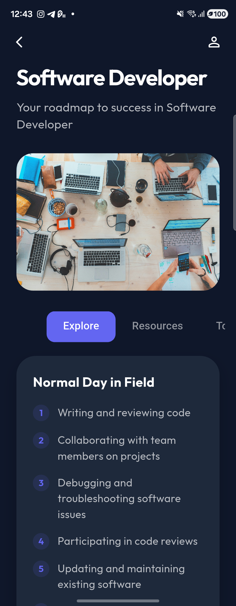 |

| Step-by-Step Career Map | Weekly Streak & Scholarships | Scholarship Explorer |
| :---: | :---: | :---: |
| 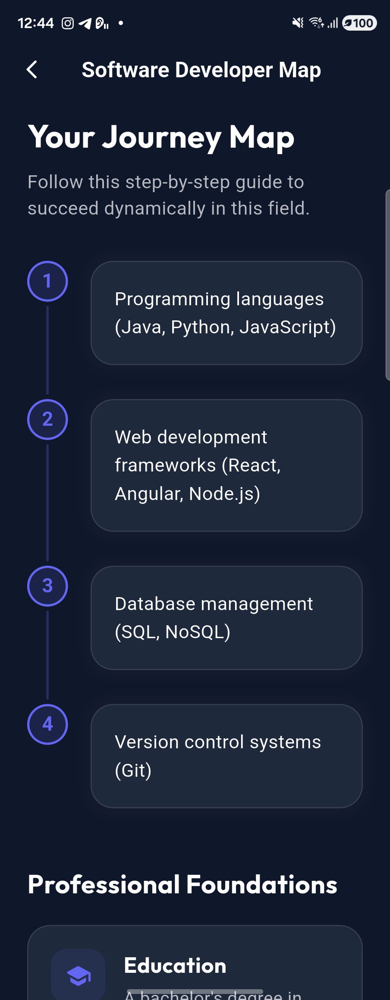 | 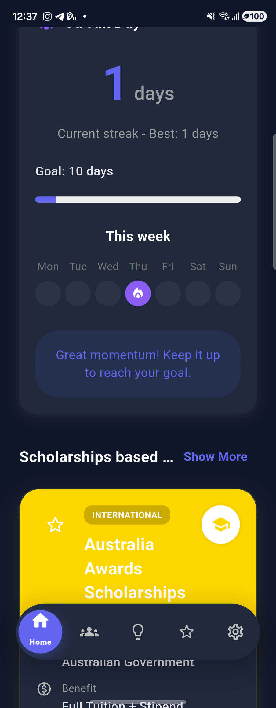 | 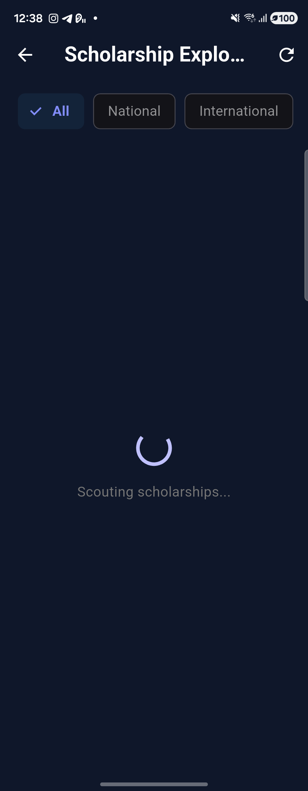 |

---

### 2.  Student Hub (Community) & Real-Time Messaging
A collaborative social feed where students share insights, photos, videos, and tags (`#technology`, `#scholarship`, `#career`), alongside real-time direct messaging and notifications.

| Student Hub (English) | Student Hub (Khmer) | Create Post |
| :---: | :---: | :---: |
| 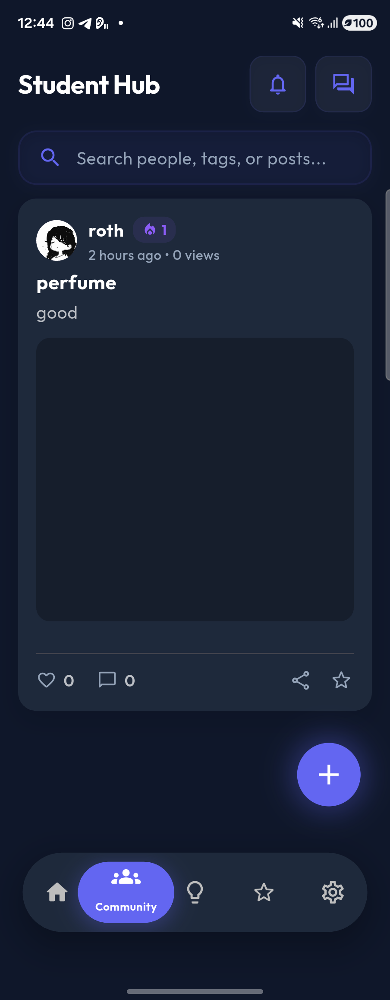 |  | 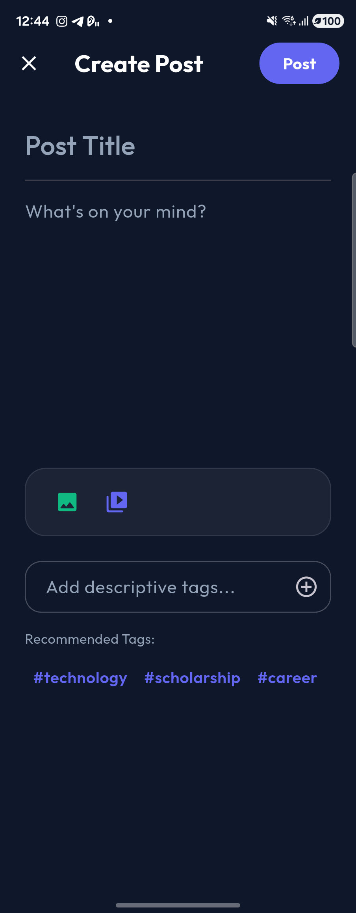 |

| Direct Messages | Notifications |
| :---: | :---: |
| 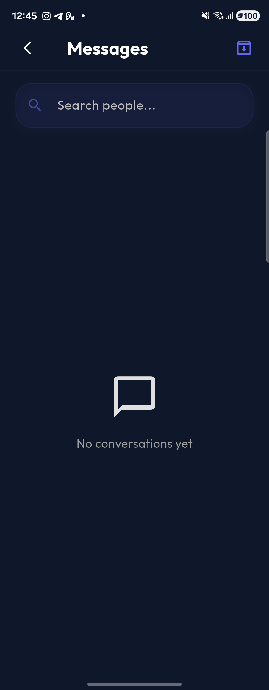 | 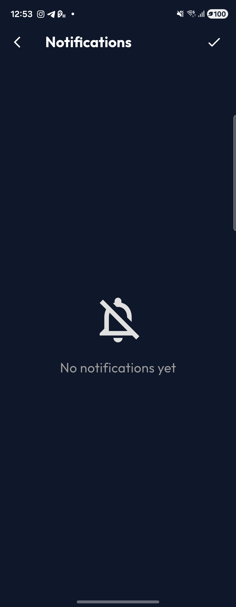 |

---

### 3.  Insight & Personal Growth Suite
Self-discovery and mental well-being toolkit featuring daily quotes, growth analytics, a 70-question NERIS Personality Test, Vision Board, Reflection Journal, Kawaii Emoticon Express, Future Milestone Map, and **AI Mind Chat** powered by Google Gemini.

| Insight Dashboard | Personal Growth Toolkit | Personality Test (NERIS) |
| :---: | :---: | :---: |
|  | 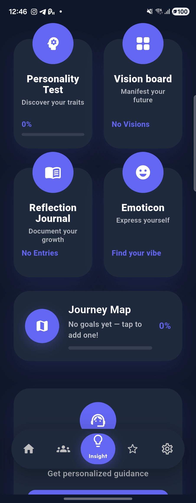 | 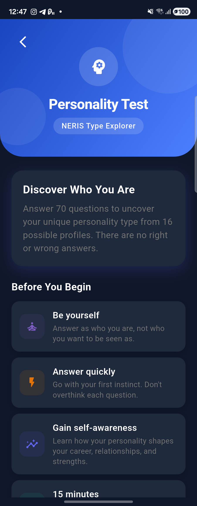 |

| Vision Board | Reflection Journal | Emoticon Vibe Picker |
| :---: | :---: | :---: |
| 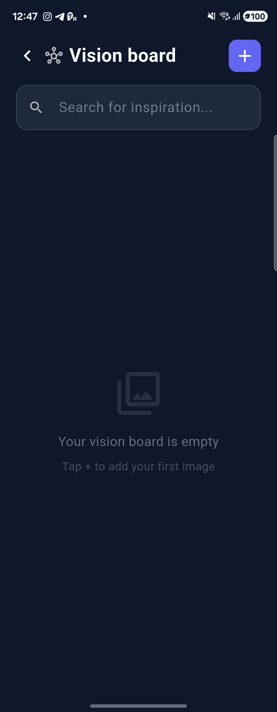 | 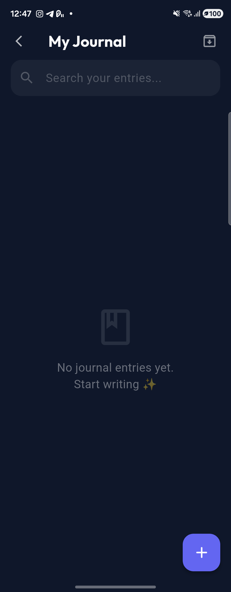 | 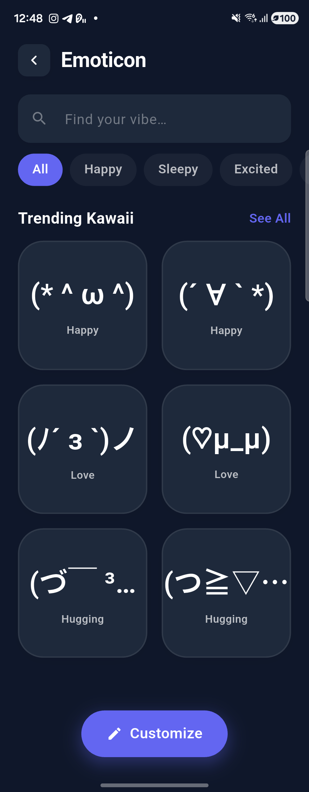 |

| Future Milestone Map | AI Mind Chat (Gemini 2.0) |
| :---: | :---: |
| 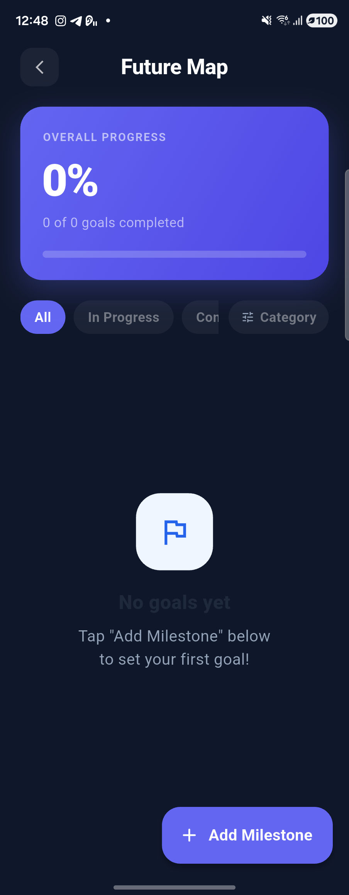 | 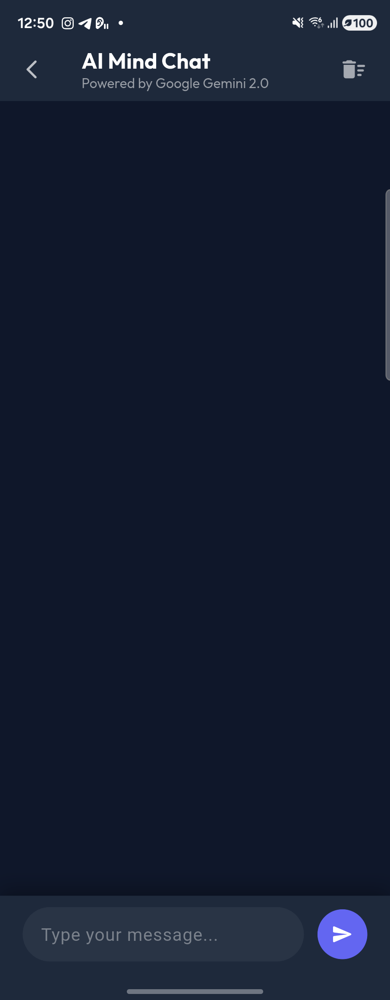 |

---

### 4.  Favorites, Profile, Subscriptions & Localization (EN / KH)
Seamless bilingual support (**English** & **Khmer / ភាសាខ្មែរ**), dark/light aesthetic modes, saved scholarships & posts, account privacy controls, and subscription management.

| Favorites (English) | Favorites (Khmer) | Subscription & Pricing |
| :---: | :---: | :---: |
| 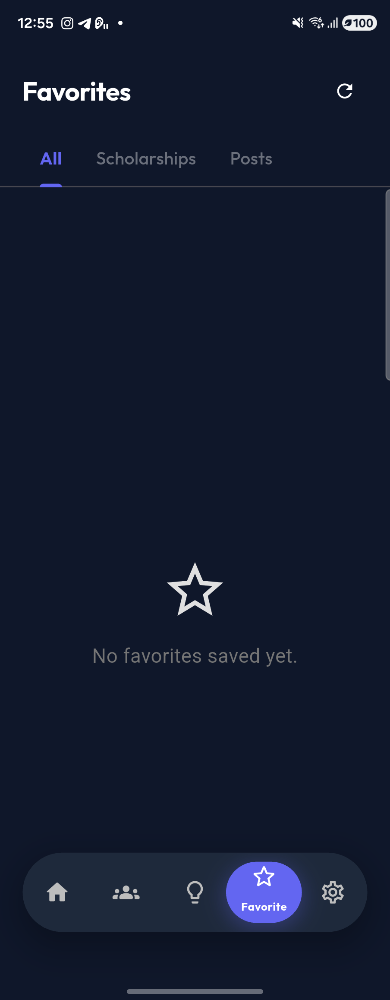 |  | 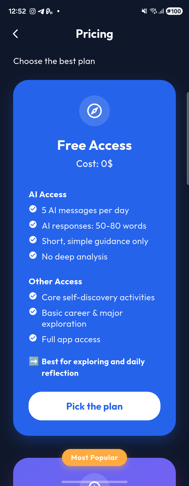 |

| Profile (English) | Profile (Khmer) | Settings & Privacy |
| :---: | :---: | :---: |
| 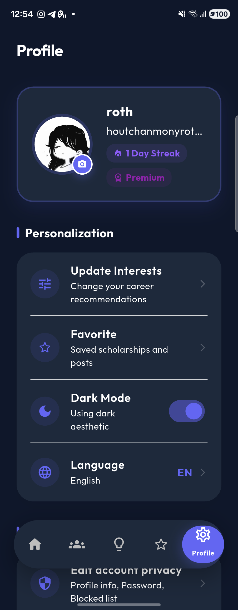 |  | 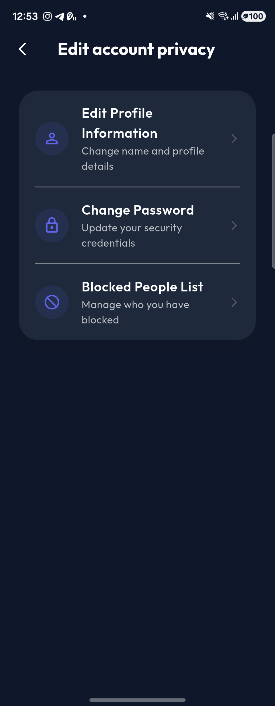 |

---

##  Key Features

- **AI Career & Major Discovery**
  - Onboarding interest & sub-interest assessment across 7 core domains (*STEM & Tech, Business, Health, Education, Craftsmanship, Public Service, Arts & Design*).
  - Side-by-side AI major & category comparison (salary ranges, market demand, work/life balance, and required skills).
  - Step-by-step career roadmaps and interactive career journey maps.
- **Scholarship Explorer**
  - Filterable national and international scholarships tailored to the user's selected categories, complete with benefit breakdowns and deadlines.
- **Student Hub (Community) & Real-Time Chat**
  - Create and browse posts with image/video attachments, tags, views, likes, comments, and bookmarking.
  - Real-time 1-on-1 messaging, typing indicators, and community notifications powered by **Socket.IO**.
- **Insight & Personal Growth**
  - **Personality Test**: 70-question NERIS Type Explorer assessment to uncover strengths and career alignment.
  - **Vision Board & Future Map**: Visual goal setting and milestone tracking with progress percentages.
  - **Reflection Journal & Emoticon**: Daily journaling and mood/vibe expression.
  - **AI Mind Chat**: Conversational AI mentor powered by **Google Gemini** & **Groq** for personalized academic and emotional guidance.
- **Bilingual Localization & Theme Customization**
  - Full **English (`en`)** and **Khmer (`km`)** localization (`flutter_localizations` & ARB translations).
  - Adaptive **Dark Mode** and **Light Mode** glassmorphic UI.

---

## 🛠️ Tech Stack

### Frontend (`frontend/`)
| Layer | Technology |
| :--- | :--- |
| **Framework** | Flutter (Dart `^3.10.4`) |
| **State & Storage** | `shared_preferences`, `flutter_secure_storage` |
| **Networking & Real-Time** | `dio`, `http`, `socket_io_client` |
| **Authentication** | `firebase_core`, `firebase_auth`, `google_sign_in`, `flutter_facebook_auth` |
| **Media & UI** | `image_picker`, `video_player`, `chewie`, `cached_network_image`, `flutter_svg`, `google_fonts` |
| **Localization** | `flutter_localizations`, `intl` (English & Khmer) |

### Backend (`backend/`)
| Layer | Technology |
| :--- | :--- |
| **Runtime & Framework** | Node.js, Express.js (`^5.2.1`) |
| **Database** | **Supabase (PostgreSQL)** via `pg` connection pool |
| **AI Services** | Google Gemini (`@google/genai`), Groq SDK (`groq-sdk`), OpenAI SDK |
| **Real-Time Engine** | `socket.io` |
| **Authentication & Security** | JWT (`jsonwebtoken`), `bcryptjs`, `google-auth-library` |
| **Media & Email** | Cloudinary (`cloudinary`, `multer`), Resend (`resend`), `nodemailer` |

---

## Project Structure

```text
Evolve/
├── assets/
│   └── screenshots/          # App UI screenshots for documentation
├── backend/
│   ├── config/               # Database adapter (Supabase PostgreSQL) & Cloudinary config
│   ├── controllers/          # Route controllers (Auth, Home, Community, Chat, AI, Insight)
│   ├── middleware/           # JWT authentication & upload middleware
│   ├── models/               # Database models & queries
│   ├── routes/               # Express REST API routes
│   ├── scripts/              # Database migration & seeding scripts
│   ├── services/             # AI & background services
│   ├── utils/                # Mail, OTP, and helper utilities
│   └── server.js             # Express + Socket.IO entry point
└── frontend/
    ├── android/              # Android native configuration
    ├── assets/               # Icons, images, and static assets
    ├── lib/
    │   ├── config/           # App constants & environment configuration
    │   ├── generated/        # Auto-generated localization classes
    │   ├── l10n/             # English (app_en.arb) & Khmer (app_km.arb) translations
    │   ├── models/           # Dart data models
    │   ├── screens/          # UI screens (Auth, Home, Community, Insight, Favorites, Profile)
    │   ├── services/         # API, Auth, Socket, and Storage services
    │   ├── theme/            # Dark/Light theme definitions & color palette
    │   ├── widgets/          # Reusable UI components & glassmorphic nav bar
    │   └── main.dart         # Flutter application entry point
    └── pubspec.yaml          # Flutter dependencies & asset declarations
```

---

## Getting Started

### Prerequisites
- **Flutter SDK** (`>=3.10.4`)
- **Node.js** (`>=18.x`)
- **PostgreSQL / Supabase** database

### 1. Backend Setup
```bash
cd backend
npm install
```
Create a `.env` file in `backend/` (never committed to Git):
```env
PORT=5000
DATABASE_URL=postgresql://<user>:<password>@<host>:6543/postgres
JWT_SECRET=your_jwt_secret
GEMINI_API_KEY=your_gemini_api_key
GROQ_API_KEY=your_groq_api_key
CLOUDINARY_CLOUD_NAME=your_cloud_name
CLOUDINARY_API_KEY=your_cloudinary_key
CLOUDINARY_API_SECRET=your_cloudinary_secret
```
Run the database schema migration and seed initial categories:
```bash
node scripts/migrate_supabase.js
npm run dev
```

### 2. Frontend Setup
```bash
cd frontend
flutter pub get
flutter gen-l10n
flutter run
```
*(Tip: When debugging on a physical Android device over USB, run `adb reverse tcp:5000 tcp:5000` so the device can reach your local backend server at `http://127.0.0.1:5000`.)*
